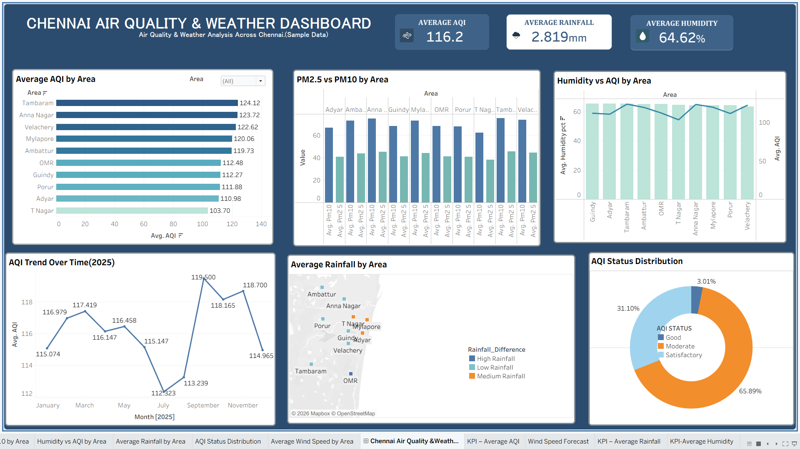

# Chennai Air Quality & Weather Dashboard (Tableau)

Note: This project uses a synthetic dataset to practise dashboard building. The findings describe this sample data, not actual Chennai air quality.

An interactive Tableau dashboard analysing air quality (AQI) and weather across 10 areas of Chennai.

## Dataset
- 3,650 daily records, 10 Chennai areas, January to December 2025
- Columns: AQI, PM2.5, PM10, temperature, humidity, rainfall, wind speed
- Source: Synthetic sample dataset generated with ChatGPT for practice (not real air quality measurements)

## What the dashboard shows
- KPI cards: average AQI (116.2), average rainfall, average humidity
- Average AQI by area, with an area filter
- PM2.5 vs PM10 by area
- Humidity vs AQI by area (dual axis)
- Monthly AQI trend
- Average rainfall by area on a map
- AQI status distribution

## Key insights(in this sample data)
- AQI was about 23% lower on rainy days (average 93 vs 120)
- Tambaram had the highest average AQI (124.1) and T Nagar the lowest (103.7)
- Monthly average AQI stayed in a narrow range of about 112 to 120 through the year
- About 66% of days were in the "Moderate" category, 31% "Satisfactory" and 3% "Good"

## Tools
Tableau Public

## Live dashboard
- https://public.tableau.com/app/profile/antanet.lydia.a/viz/ChennaiAirQualityWeatherDashboard/ChennaiAirQualityWeatherDashboard

